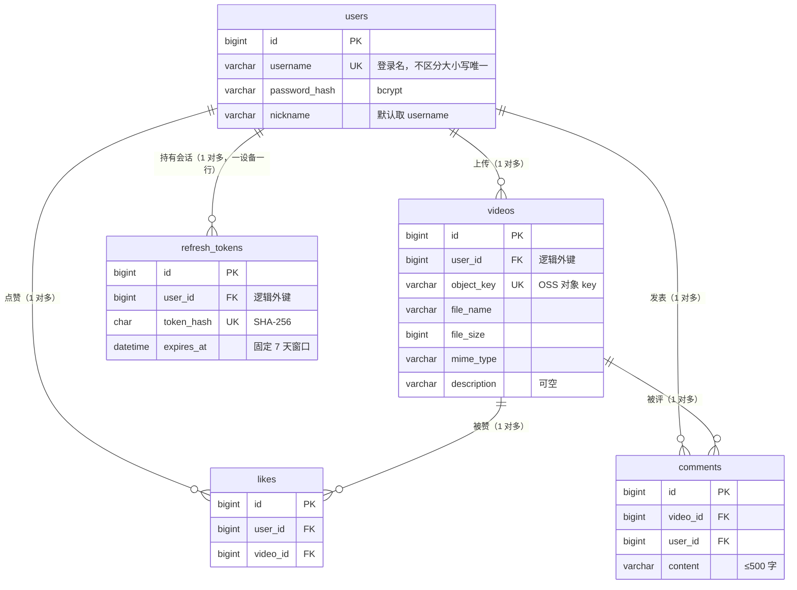

# GoTikTok V1 数据库设计（Database Design）

> 本文档为 GoTikTok 的**数据库设计文档**：表结构、索引与查询模式的权威依据；GORM AutoMigrate 以本文档为准。
> 依据：`docs/v1-spec.md` + `docs/api-contract.md`（2026-08-18）+ 2026-08-29 确认双 token。
> 标记【默认值】的条目为起草时的合理默认，实现前仍可调整。

---

## 一、ER 图（实体关系）

- 关系均为 **1 对多**，无多对多（likes 本身就是 users×videos 的关联表，带唯一约束 `(user_id, video_id)`）
- 所有"FK"均为**逻辑外键**（应用层保证，不建数据库外键约束，见全局约定）
- created_at 全表通用、图中省略；updated_at 仅可更新表有（users / refresh_tokens / videos），likes / comments 不可变、无 updated_at（2026-09-08 修订：原"全表通用"表述与表结构矛盾）

---

## 二、全局约定

| 项 | 约定 |
|---|---|
| 引擎 | InnoDB |
| 字符集 | utf8mb4，排序规则 utf8mb4_0900_ai_ci（要求 MySQL 8.0+，compose 需钉版本） |
| 主键 | 各表自增 `id`（BIGINT UNSIGNED），列表游标即主键 |
| 时间字段 | `created_at` 全表均有；`updated_at` 仅可更新表（users / refresh_tokens / videos）有，DATETIME(3)，DEFAULT CURRENT_TIMESTAMP(3)，updated_at 随更新自动刷新。**不可变表（likes / comments）无 updated_at**【2026-09-08 修订：原"各表通用"与 likes/comments 表结构矛盾】 |
| 外键 | **不建数据库外键约束**【默认值】，表间引用靠应用层保证。理由：迁移灵活、避免锁与级联坑；GORM 仅用逻辑关联 |
| 迁移 | GORM AutoMigrate（迭代 1 起），设计文档作为表结构权威依据。**分阶段策略**【2026-09-07 补充】：① 开发期（迭代 1～上线前）用 AutoMigrate，表结构快速演进零成本；② 上线日以真实 schema 生成基线迁移（baseline），作为迁移体系起点；③ 上线后关闭 AutoMigrate，结构变更一律走迁移文件（届时引入 golang-migrate）。能力边界：AutoMigrate **只做加法**（建表/加列/加索引），列类型仅有限调整（size/精度/nullable）；**不删列、不删索引、不处理改名**。破坏性变更（删列、改类型、改名）需迁移文件或手工 SQL |
| 删除 | 评论硬删除；refresh token 轮换/过期即失效；视频、用户 V1 无删除场景 |

---

## 三、表结构

### 3.1 users（用户）

| 字段 | 类型 | 约束 | 说明 |
|---|---|---|---|
| id | BIGINT UNSIGNED | PK, AUTO_INCREMENT | |
| username | VARCHAR(64) | NOT NULL, UNIQUE | 登录名；排序规则不区分大小写，故 "Bob"/"bob" 视为重复 |
| password_hash | VARCHAR(100) | NOT NULL | bcrypt 哈希（60 字符，留余量） |
| nickname | VARCHAR(64) | NOT NULL | 匿名昵称，注册时默认取 username |
| created_at | DATETIME(3) | NOT NULL | |
| updated_at | DATETIME(3) | NOT NULL | |

- 索引：`uk_users_username(username)`（唯一键自带）

### 3.2 refresh_tokens（刷新凭证，2026-08-29 新增）

双 token 认证：access token 为无状态 JWT 不落库；refresh token 为随机串，**仅存 SHA-256 哈希**，一行即一个设备会话。

| 字段 | 类型 | 约束 | 说明 |
|---|---|---|---|
| id | BIGINT UNSIGNED | PK, AUTO_INCREMENT | |
| user_id | BIGINT UNSIGNED | NOT NULL | 逻辑外键 → users.id |
| token_hash | CHAR(64) | NOT NULL, UNIQUE | SHA-256 十六进制（32 字节 → 64 字符），明文不落库 |
| expires_at | DATETIME(3) | NOT NULL | 登录时定为 now+7 天，**固定窗口：轮换不延长**【已确认 2026-08-29，比选详情见 `docs/v1-spec.md` 第四节】；过期即失效，懒删除【默认值】 |
| created_at | DATETIME(3) | NOT NULL | |
| updated_at | DATETIME(3) | NOT NULL | |

- 索引：
  - `uk_refresh_tokens_token_hash(token_hash)` —— 刷新接口按哈希点查
  - `idx_refresh_tokens_user_id(user_id)` —— 用户维度清理/吊销预留
- 轮换实现：刷新时按 token_hash 查行 → 校验 expires_at → 签发新串、**条件更新**该行为新哈希（expires_at 不动）→ 返回新 access/refresh token；旧串自然失效
- 轮换的并发安全【2026-09-07 修订】：UPDATE 必须带条件 `WHERE id = ? AND token_hash = 旧哈希`（CAS/乐观锁——"改前确认没被别人动过"，同 Git push 被拒的思想）。不加条件的后果：两个标签页并发持同一旧 token 刷新时双双"成功"，后写者覆盖先者的新哈希，先者拿到废票而不自知（下次刷新才被踢）。条件更新后：一方成功（影响行数 1），另一方影响行数 0 → 返回 401 重新登录，数据库永远只存一把有效钥匙
- 多设备：每次登录 INSERT 新行，会话互相独立；重新登录不删旧行【默认值：不互踢】

### 3.3 videos（视频）

| 字段 | 类型 | 约束 | 说明 |
|---|---|---|---|
| id | BIGINT UNSIGNED | PK, AUTO_INCREMENT | 列表游标与排序依据 |
| user_id | BIGINT UNSIGNED | NOT NULL | 上传者，逻辑外键 → users.id |
| description | VARCHAR(140) | NULL | 描述文案，可选；空则不展示 |
| file_name | VARCHAR(255) | NOT NULL | 原始文件名 |
| object_key | VARCHAR(255) | NOT NULL, UNIQUE | OSS 对象 key，如 `uploads/1/xxx.mp4` |
| file_size | BIGINT UNSIGNED | NOT NULL | 字节数 |
| mime_type | VARCHAR(100) | NOT NULL | 如 video/mp4 |
| created_at | DATETIME(3) | NOT NULL | |
| updated_at | DATETIME(3) | NOT NULL | |

- 索引：
  - `idx_videos_user_id(user_id)` —— 按用户查列表（预留）
  - 列表按 id 倒序走主键，无需额外索引
- 唯一键 `uk_videos_object_key(object_key)` 防重复登记（上传流程第③步幂等）

### 3.4 likes（点赞）

| 字段 | 类型 | 约束 | 说明 |
|---|---|---|---|
| id | BIGINT UNSIGNED | PK, AUTO_INCREMENT | |
| user_id | BIGINT UNSIGNED | NOT NULL | 逻辑外键 → users.id |
| video_id | BIGINT UNSIGNED | NOT NULL | 逻辑外键 → videos.id |
| created_at | DATETIME(3) | NOT NULL | |

- 索引：
  - `uk_likes_user_video(user_id, video_id)` —— 点赞唯一性（幂等核心）
  - `idx_likes_video_id(video_id)` —— 点赞计数 COUNT 用
- 无 updated_at（记录不可变）

### 3.5 comments（评论）

| 字段 | 类型 | 约束 | 说明 |
|---|---|---|---|
| id | BIGINT UNSIGNED | PK, AUTO_INCREMENT | 列表游标与排序依据 |
| video_id | BIGINT UNSIGNED | NOT NULL | 逻辑外键 → videos.id |
| user_id | BIGINT UNSIGNED | NOT NULL | 逻辑外键 → users.id |
| content | VARCHAR(500) | NOT NULL | 非空校验在应用层 |
| created_at | DATETIME(3) | NOT NULL | |

- 索引：`idx_comments_video_id(video_id, id)` —— 评论列表按 (video_id, id 倒序) 游标查询
- 无 updated_at（记录不可变：发表后内容不可编辑，删除走硬删除）（2026-09-08 补充，对齐 likes 写法）
- 删除：硬删除（作者删除后彻底消失）

---

## 四、查询模式（与接口契约对应）

| 接口 | SQL 要点 |
|---|---|
| 视频列表 | `SELECT v.id, v.description, v.file_name, v.object_key, v.created_at, u.id, u.nickname FROM videos v JOIN users u ON u.id = v.user_id ORDER BY v.id DESC LIMIT 21`（多取 1 判断 has_more）；带 cursor 时 `WHERE v.id < ?`。JOIN 一次带出作者昵称——实时取、作者改名后旧视频同步变，且避免逐条查作者的 N+1（2026-09-07 补充） |
| 视频详情 | `WHERE v.id = ?`，JOIN users 同上（播放页展示作者昵称） |
| 点赞计数 | 批查询：`SELECT video_id, COUNT(*) AS cnt FROM likes WHERE video_id IN (?, ?, ...) GROUP BY video_id`——列表页每页固定 1 次，结果按 video_id 回填；无赞视频不在结果集中，代码补 0（2026-09-07 修订：原为每项一次 COUNT，属 N+1 写法） |
| 评论计数 | 同上（comments 表，同一次列表请求各 1 次） |
| 是否已赞 | `SELECT 1 FROM likes WHERE user_id = ? AND video_id = ?` |
| 点赞/取消 | 唯一键保证幂等；INSERT ... ON DUPLICATE KEY / DELETE 均可重放 |
| 评论列表 | `SELECT c.id, c.content, c.created_at, u.id, u.nickname FROM comments c JOIN users u ON u.id = c.user_id WHERE c.video_id = ? [AND c.id < ?] ORDER BY c.id DESC LIMIT 21`——JOIN 一次带出发评人昵称，避免逐条查作者的 N+1（2026-09-08 补充：视频列表/详情补 JOIN 时遗漏了本条，同款理由） |
| 删除评论 | 先 `SELECT user_id FROM comments WHERE id = ?`：不存在 → 404 COMMENT_NOT_FOUND；存在但非本人 → 403 FORBIDDEN；判定通过后 `DELETE WHERE id = ?`（2026-08-29 修订：原设计仅凭 DELETE 影响行数判 403，无法区分"评论不存在 404"与"非本人 403"两种场景，与接口契约的两个错误码矛盾） |
| 登录/刷新 | `WHERE token_hash = SHA256(?) AND expires_at > NOW(3)`；刷新成功后 UPDATE token_hash（轮换，expires_at 不动——固定窗口） |

---

## 五、计数策略说明

- 点赞数/评论数**直接读库 COUNT**，无缓存【已确认：V1 不引入 Redis】
- 列表页计数用**批查询**（`IN + GROUP BY`，见上表）：点赞数一次、评论数一次，列表页共固定 **3 次查询**（1 列表 + 2 计数），与页大小无关（2026-09-07 修订：原稿"每项一次 COUNT、共 2N 次"为 N+1 写法；批查询零成本且更优，定为 V1 默认。上缓存的正确顺序：**先消灭 N+1，再谈缓存**）

---

## 六、演进备注

- **refresh token 物理清理**【默认值：V1 懒删除即可】：后续可在 worker 进程定期 `DELETE WHERE expires_at < NOW(3)`
- **登出/吊销**：V1 无登出接口；如需"踢出全部设备"，按 `idx_refresh_tokens_user_id` 删该用户全部行即可，表结构已预留
- **会话窗口调整**：若未来改滑动窗口（轮换时延长 expires_at）或加绝对上限（新增 absolute_expires_at 列），表结构均兼容，只动更新逻辑
- **加 Redis（V1 完成后的评估项）**：优先缓存点赞/评论计数，写路径"先写库再更新缓存"，缓存失效兜底回源
- **关注（V2）**：新增 follows 表，与 likes 同构（user_id, target_user_id, created_at）
- **视频删除/审核（如未来引入）**：videos 增加 status 字段（TINYINT）软删除，OSS 对象回收走生命周期规则
